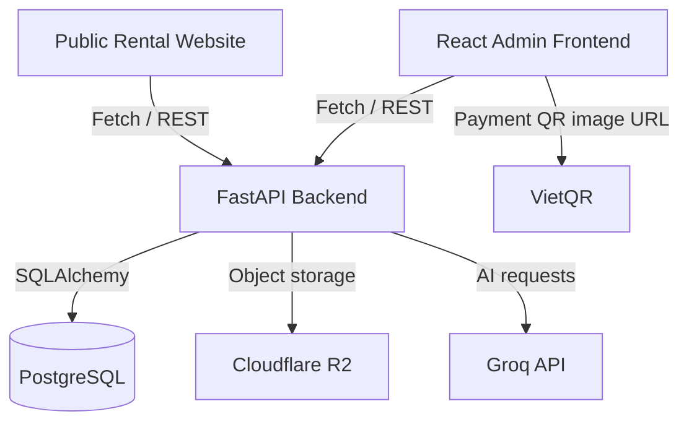

# Rosehome Rental Management

**Full-stack Rental Property Management System**

## Project Overview

Rosehome is a personal full-stack project for managing rental rooms, tenants, contracts, electricity billing, invoices, payments, deposits, and checkout settlements. It combines an administrative interface, a public rental website, and a Python API.

This snapshot is intended for recruiters and engineers reviewing the application's source code, data model, and business workflows.

## Tech Stack

| Area | Technologies evidenced in the source |
| --- | --- |
| Frontend | React, TypeScript, Vite, Tailwind CSS, shadcn/ui, React Router, Fetch API |
| Backend | Python, FastAPI, Pydantic, SQLAlchemy, Alembic |
| Database | PostgreSQL |
| Integrations | VietQR, Cloudflare R2 through an S3-compatible client, Groq API through an OpenAI-compatible client |
| Reporting | Recharts, SheetJS |
| Testing | Python unit/regression tests and UI regression checks, including a Node-based invoice export harness |

## Key Features

- **Room & Tenant Management:** room records, tenant profiles, and occupancy-related workflows.
- **Rental Contract Management:** contracts, occupants, rental terms, and contract termination.
- **Electricity Billing:** meter readings, billing periods, and electricity transition handling.
- **Invoice Lifecycle Management:** draft preparation, issuing, cancellation, replacement, and invoice export.
- **Partial Payment Tracking:** payment records, outstanding balances, and debt reporting.
- **Deposit & Checkout Settlements:** deposit transactions and checkout settlement preparation and execution.
- **JWT Authentication & Role-Based Access:** token authentication and backend role checks.
- **Dashboard & Reporting:** operational summaries, charts, and debt views.
- **Excel Export:** spreadsheet exports for invoice and debt information.
- **AI Assistant Integration:** a chat interface backed by a configurable Groq integration.

These features describe the implementation present in the source, not a verified deployment of this snapshot.

## System Architecture

The backend is a modular monolith, with API routers, schemas, models, and services.



External services require separate configuration. The diagram describes integration boundaries; it does not represent active connections or independently deployed microservices.

## Technical Highlights

- REST API development with FastAPI routing and Pydantic request/response schemas.
- Relational modeling across rooms, contracts, invoices, payments, and deposits.
- JWT authentication and role-based authorization checks.
- Financial workflow handling across invoice lifecycle, partial payments, debts, and checkout.
- Unit and regression test source covering billing calculations and selected UI/export behavior.

## Project Structure

```text
frontend/
  src/
    api/           Fetch client
    components/    Shared UI, forms, and mobile components
    pages/         Administrative screens
    types/         TypeScript data types
backend/
  app/
    api/           API routers
    models/        SQLAlchemy models
    schemas/       Pydantic schemas
    services/      Business services and integrations
  migrations/      Historical Alembic migration source
  tests/           Unit and regression test source
public-web/
  src/
    data/          Synthetic room examples
    lib/           Public API client and utilities
    pages/         Public rental pages
```

## Public Portfolio Snapshot

This repository is a curated source-code snapshot prepared for portfolio review. It is not a verified standalone deployment.

The portfolio excludes production credentials, private environment files, Android signing materials, real tenant/payment records, and some assets and platform configuration. It is intended for source review rather than a clone-and-run installation.

## Security & Privacy

- Secrets and production credentials are not supplied with this portfolio. Integrations read configuration from environment variables.
- Room examples in `public-web/src/data/rooms.ts` are explicitly synthetic, including illustrative pricing and fees.
- Contact examples use generic hints or `example.com` email addresses. Hardcoded contact actions on the room detail page are disabled for the demo.
- The invoice PNG test uses a non-payable account placeholder and mocked image loading; it does not send a payment or fetch a QR image.
- API clients default to localhost, and the backend frontend-origin default is local. No production connection settings are provided.
- Real integrations remain in the source. Executing the application with supplied environment settings may contact the configured services; this is not an offline sandbox.
- Use only isolated local/demo configuration and synthetic data. Do not supply production databases, credentials, or customer records.

Static cleanup is not a security certification or a guarantee that all possible sensitive content has been detected.

## Testing

The included test source covers checkout settlements and UI steps, first-month electricity, electricity transitions and billing regressions, invoice preparation, invoice PNG payment rendering, and payment-void UI behavior.

Some UI regression checks inspect frontend source; the PNG harness uses TypeScript/Node tooling and mocked browser APIs. Their presence should not be interpreted as complete end-to-end coverage.

**Builds and tests have not been executed on this portfolio snapshot.** No passing build or test status is claimed.

## Limitations

- The imported `frontend/assets/splash-mobile.png` is absent.
- Referenced assets are missing: `frontend/public/favicon.svg`, `frontend/public/Rosehome.png`, and `public-web/public/favicon.svg`.
- `backend/alembic.ini` and `backend/migrations/script.py.mako` are absent; the included migration source is not a complete migration setup.
- Android project/build/signing artifacts are not included. Capacitor configuration and package references remain in the frontend.
- Standalone runtime, dependency installation, compilation, and visual behavior have not been verified.
- Public pages still use API-backed data. The synthetic room file does not turn the entire application into an offline demo.
- Production data and credentials are not provided. Local setup and integration configuration must be reviewed separately before execution.

## Contact

No personal contact details are included in this snapshot.
